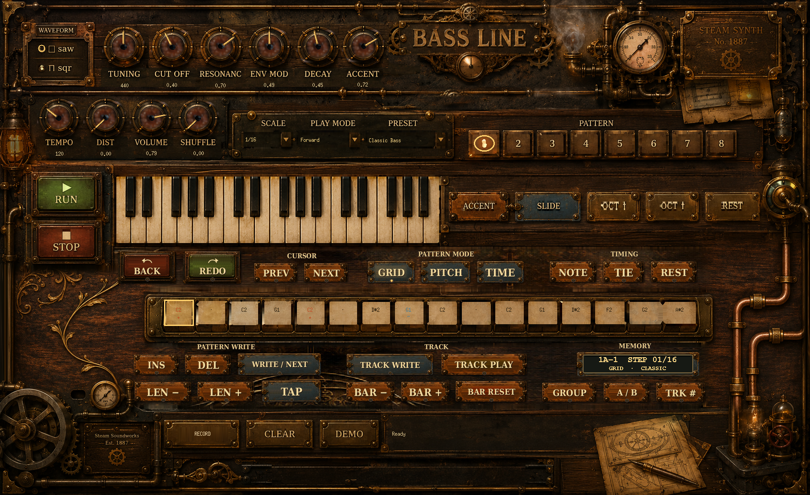
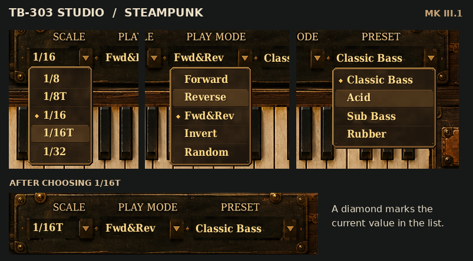

# TB-303 Studio · Classic Edition

For the separate **Roland TB-303 (photo)** view, see the [photographic panel guide](ROLAND-PANEL.md). The controls below describe the eleven Studio skins.

Open a terminal in the studio's folder (**TB303-Studio** when cloned from GitHub), and run `python3 Launch_TB303_MkIII.py` (Windows: `python Launch_TB303_MkIII.py`). Use the same Python environment as your previous installation. The window title reads **Front Panel Mk III.2**. Look for **BACK** and **REDO** just below the keyboard. The original sixteen step keys sit between the upper editing controls and the lower track and memory controls.

| Front panel | What it does |
|---|---|
| Transport and CURSOR: BACK / REDO; PREV / NEXT | BACK and REDO undo and redo edits. The two smaller keys to their right move the cursor. BACK and REDO light up when available. |
| PATTERN: GRID, PITCH, TIME; NOTE, TIE, REST | GRID restores the step editor. PITCH enters notes from the keyboard. TIME writes attacks, ties and rests. A timing key can also write directly to the selected step. |
| WRITE: INS, DEL, WRITE / NEXT; LEN −/+, TAP | INS and DEL shift steps, or bars in Track Write. LEN changes the pattern length. TAP previews the current entry and advances; during track playback it requests D.S. |
| TRACK: TRACK WRITE, TRACK PLAY; BAR −/+, BAR RESET | TRACK WRITE selects the track editor. WRITE / NEXT writes the current pattern into a bar and advances. TRACK PLAY starts or stops the track. BAR −/+ selects a bar; PREV/NEXT still moves the pattern cursor. |
| MEMORY: GROUP, A/B, TRK # | GROUP cycles through four groups, A/B switches section, and TRK # cycles through tracks 1–7. The eight pattern buttons select a slot within that section. |

**Changing a value:** click SCALE, PLAY MODE or PRESET. In the list, the diamond marks the current setting; the highlighted row is the choice under the pointer. Click a row to apply it. Click elsewhere to close the list without changing anything or playing a note.

With the keyboard, Tab focuses a field and lights its arrow. Down or Space opens it; arrows and Home/End move through the list, Enter selects, and Escape cancels. With the list closed, Left and Right change the value directly.

**Try it:** click step 1, change its note on the large keyboard, then press NEXT. BACK restores the original note and cursor; REDO applies the edit again. To cancel a mouse click, drag off the key before releasing it. [Watch the actual clicks](docs/BACK-REDO_MkIII.gif).

To hear a complete track, open **Projects/Classic_Pitch_Time_Track.tb303** using **File → Open project**. Leave all rows unchecked and select **Load all**. Press **TRACK PLAY** on the front panel. The example starts on 1A-1 in sixteenths and switches to 1B-1 in triplets. **F6** and **F7** open the detailed editors for transposition, D.C./D.S., tap entry and WAV export.

## Switch riffs while playing

Open [Live_Pattern_Switch.tb303](Projects/Live_Pattern_Switch.tb303) and load the entire project. Start **RUN** on **1A-1**. During the loop, click pattern **2** or press the corresponding Akai pad. **1A-1** keeps playing. The display reads **NEXT: 1A-2**, and a dotted outline marks the queued button. At the end of the final step, pattern **1A-2** takes over from its first event, even if the interface is busy.

- Selecting another slot before the boundary replaces the queued pattern. Select the current one again or press **Esc** on the front panel to cancel.
- **STOP** also cancels the request. With playback stopped, pattern selection is immediate. Queued requests are not stored in project files.
- The boundary follows the pattern actually playing, including its length, tempo, triplets, shuffle and the return trip in **Fwd&Rev** mode. The next pattern uses its own playback order. In real time, a voice change keeps the audio stream running, including during recording.
- **Sequencer → MIDI Clock (24 PPQN) → Arm current pattern** makes the external clock determine the boundary. The pygame fallback pre-renders the patterns: if the next one is not ready, the current one plays for another loop. Track playback follows the score.

[Listen to the four-second example](Audio_Demos/TB303_Live_Pattern_Switch.wav): the request is made on **step 11**, at **1.30 s**; the higher riff starts at **2.00 s**. [See the queued pattern on the display](docs/Pattern_Live_MkIII.jpg).

## Undo a mistake

| Control | Result |
|---|---|
| PREV / NEXT; Akai CC 115 / 116 | Move without writing a note or adding to history. In Pitch mode they move between pitches. |
| BACK · Ctrl+Z | Undo an edit and return to its pattern and cursor, even after navigating elsewhere. |
| REDO · Ctrl+Y or Ctrl+Shift+Z | Restore an undone edit. Making a new edit clears the redo list. |
| Drag a knob | One drag is one undo. A burst of wheel or MIDI CC changes to the same knob is grouped. |

The history holds up to 96 edits, including Clear, MIDI notes, pattern imports, instruments, settings and track bars. Auditioning, navigating and changing skin do not add history entries. Opening a different complete project starts a fresh history. Undo does not remove audio recordings or revert files already saved to disk. The Studio deliberately extends BACK beyond the note-entry correction available on the original instrument.

[See the Pitch / Time editor](docs/Classic_Pitch_Time.png) · [See the Track editor](docs/Classic_Track.png)

## Write a pattern in two passes

1. Choose an empty **Group / Section / Pattern** slot. There are 4 groups × 2 sections × 8 patterns. The eight front-panel buttons and MIDI pads address the selected section. **4B-8** is slot 64.
2. Select **Pitch**, then play **C2, E2, G2** on either keyboard. Each key writes a pitch and advances. PREV/NEXT lets you revisit an entry. Accent and Slide modify the selected pitch. A slide goes from the marked note to the next one; MIDI legato marks the starting note.
3. Select **Time**, set **Length** to **4**, then enter **Note, Tie, Rest, Note**. You hear *C held, a rest, E*. G is still stored. Change the third step from Rest to Note and the pattern becomes *C held, E, G*. A tie after a rest stays silent.
4. Press **RUN** to loop the result. **TAP / Check** previews an entry and advances. **FUNCTION** returns to Grid. In Track Write, **WRITE / NEXT** writes a bar and advances.
5. For manual rhythm entry, select **Arm / Cancel Tap**, tap the attacks, then select **Apply rhythm**. The first tap sets the start. Attacks snap to the pattern's tempo, grid and shuffle. Untapped steps become rests, and unused pitches stay in the list.

Length (1–16) is independent of the grid. At 120 BPM, **12 steps at 1/16** last 1.5 s; **12 steps at 1/8T** last 2 s. Shortening a pattern hides its tail; lengthening it restores those steps. **INS Step / DEL Step** shift the active portion without changing its length. Inserting at the end can displace the final active step; BACK restores it. Note and pattern transposition use semitones. The octave buttons remain available.

**Chain patterns from** loops the selected range of slots within the section without writing a track. In the pitch list, + means accent and ~ means slide. In the timing grid, TIE holds a note, a dot means rest, and ? means an attack with no pitch entered yet. An × on the front panel marks an inactive step.

## Write and play a track

A track holds **references** to patterns. Transposing a bar does not rewrite its pattern. Select a row, choose the pattern and transposition above, then press **WRITE / NEXT**. **INS Bar / DEL Bar** shift the following bars and markers. **Set SEGNO** marks the destination for D.S.; **Set D.C. (end)** marks the last bar to play. Select a marker again to remove it.

During internal track playback, D.S. and BAR RESET take effect at the next bar boundary. During pattern playback, BAR RESET returns to step 1. Each bar uses its pattern's tempo, grid, shuffle, instrument and settings. Ties and slides can cross the boundary when both bars use the same voice. Changing instruments starts a separate voice.

Track playback uses a snapshot taken at the start. Stop and restart to hear track edits. **Export track to WAV...** writes one pass from the first bar through D.C. The File menu's pattern exporter remains separate. **Record** captures the live output, including a D.S. jump. The pygame fallback prepares the bars before playback and jumps to pre-rendered audio. Use the real-time engine for voice continuity across jumps.

There are **7 independent tracks of 64 bars each**. The Studio does not emulate the 1982 machine's shared track memory.

## Compare the sounds

- A new project uses **Classic**. Older projects open in **Legacy**. The **Sound** selection applies to the project, independently of the skin, instrument files and “Classic Bass” preset.
- Classic slides in semitone space without retriggering the envelope. Accent affects the filter and level. Its decay stays short even at high Decay; with increasing resonance, closely spaced accents can affect subsequent notes. The four-stage filter has an offset first pole. Square-wave pulse width varies with pitch; its slope is an approximation.
- [Legacy vs. Classic](Audio_Demos/TB303_Legacy_vs_Classic.wav): Legacy from 0–4 s, 0.75 s of silence, Classic from 4.75–8.75 s. Both software engines play the same sawtooth riff at 120 BPM with the same accents and slides, no distortion and matched integrated loudness. The example does not include a recording of a hardware Roland.
- Audio import fits the timbre using the current project profile. The command-line converter accepts `--profile classic` and `--profile legacy`. Automatic tempo estimation covers 60–200 BPM; you can supply a fixed tempo between 40 and 300 BPM. Audio-to-pattern conversion analyzes a 16-step excerpt.

## MIDI and hardware

**Sequencer → MIDI Clock (24 PPQN)** arms a pattern or track for an external clock. Send START followed by CLOCK. STOP pauses, CONTINUE resumes, and another START restarts from the beginning. If pulses stop, the output falls silent. The external clock overrides playback tempo without changing the saved BPM. This requires a real-time audio device, MIDI input and working drivers. To choose the port at startup: `python Python_Scripts/tb303_studio.py --midi-port="port name"`. The regular Akai CC assignments still work.

A MIDI DIN port and the original TB-303's **Sync In** do not use the same protocol. For a hardware DIN Sync source, use an interface that converts **DIN Sync to MIDI Clock**. This edition does not provide CV/Gate output or analog Mix In.

## Projects and testing

**.tb303 format v4** preserves unused pitches, ties, length, sound profile and tracks. Versions 1–3 load in Legacy; their eight slots map to 1A-1…1A-8. To keep a project usable with an older Studio, save the v4 copy under a different name. A complete save includes tracks; a partial export contains only the checked patterns. Patterns imported into another project use the destination's sound profile. Older projects referring to the factory samples by their previous names still resolve them.

See the [main README](README.md) for installation. Offline Classic rendering adds no compulsory audio-device dependency. The real-time engine uses Numba and sounddevice. WAV rendering remains available without an audio output.

From the Studio folder run `python -m unittest discover -s Tests -v`. GUI tests require a visible Tk display; DSP, MIDI pulse, transport and WAV tests do not require physical audio hardware. Converter tests use SciPy. See [validation notes and limitations](VALIDATION-CLASSIC.md).

### References from the original guide

- [Roland TB-303 Owner's Manual](https://cdn.roland.com/assets/media/pdf/TB-303_OM.pdf): Pitch/Time entry, triplets, track markers and inserting bars.
- [R. Whittle, Devil Fish Manual](https://www.firstpr.com.au/rwi/dfish/Devil-Fish-Manual.pdf): original operation and Devil Fish modifications.
- [R. Burnett, TB-303 square-wave measurement](https://synth-diy.org/pipermail/synth-diy/2015-October/150013.html).
- [Kenton: converting between MIDI and DIN Sync](https://kentonuk.com/support/converting-between-midi-and-din-sync/).

