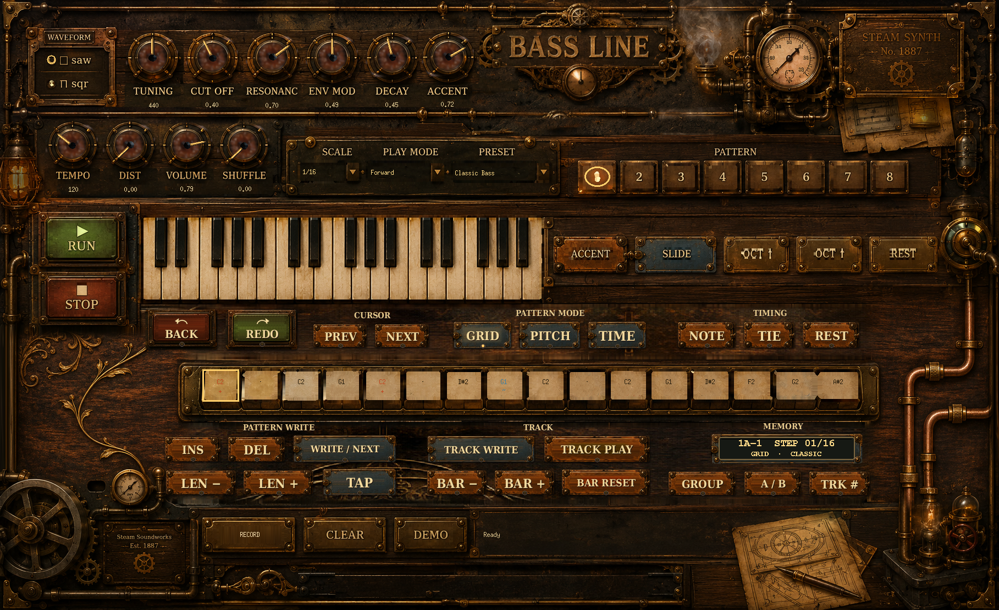
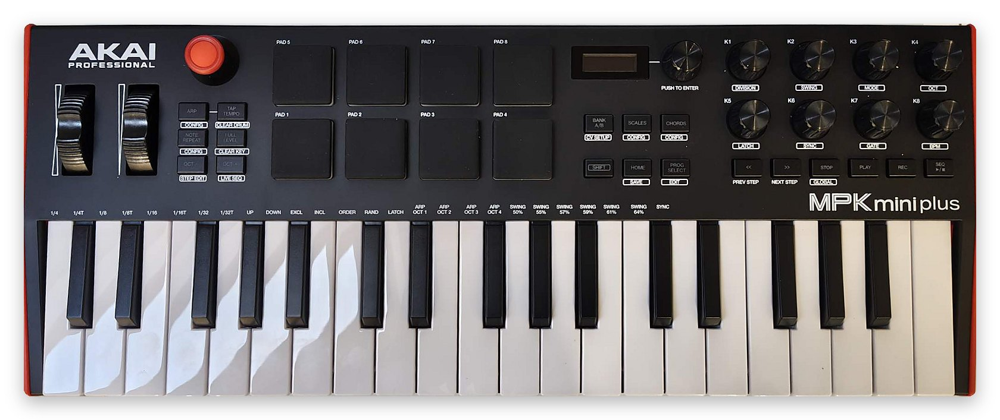
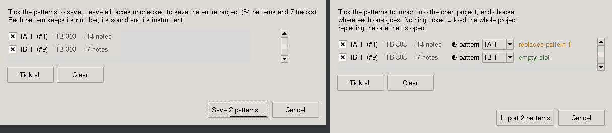

# TB-303 Studio — Bass Line (acid synth + steampunk skin)

**Classic Edition · Front Panel Mk III.2 (project format v4).** [Illustrated guide and playable examples](CLASSIC-GUIDE.md).

**New: [Roland TB-303 photographic front panel](ROLAND-PANEL.md).** Choose **Panel → Roland TB-303 (photo)** or run `python3 Launch_Roland_TB303.py`. Turn the photographed controls, edit pitches and timing on the original keys, and follow the actual transport on the panel lamps. F9 compares the live face to the untouched original. The Studio skins and the photo share playback and projects.

Each of the eleven Studio instruments has 24 working switches set into its own case. Find BACK and REDO below the keyboard, and the writing, track and memory keys below the sixteen steps. **BACK / REDO** undo and redo edits. **PREV / NEXT** move the cursor. The window title reads **Front Panel Mk III.2**.

[See the SCALE, PLAY MODE and PRESET drawers](docs/TB303-MkIII.1-Selectors.png).

During pattern playback, press another pattern button to queue it. The display shows **NEXT**; the switch happens when the current loop ends. [Open the example project](Projects/Live_Pattern_Switch.tb303) or [listen to the WAV](Audio_Demos/TB303_Live_Pattern_Switch.wav).

The eight pattern buttons select slots within the current section. The Classic sound profile is independent of the skin; projects from versions 1–3 open in Legacy.

**by Stéphane "ZFEbHVUE"**



[Compare all eleven finished instruments](docs/Inlaid_Skins_MkIII.jpg).

An *acid* bass synthesizer inspired by the Roland TB-303, written in Python with NumPy
(and Numba for real-time audio). It comes with an image-skinned steampunk interface, a
real-time audio engine, a sampler that plays **real instruments** — one instrument per
pattern — and full control from an **Akai MPK mini Plus** MIDI keyboard.

> **Technical honesty.** This is **not** a component-accurate clone of the TB-303
> circuit. It is a **character emulation**: anti-aliased saw/square oscillator, a
> resonant ~18 dB/oct ladder filter swept by the envelope, accent, slide, and a
> sequencer with swing. The eleven Studio skins use original panel art. The separate photo view uses a photograph of a
> Roland unit from Wikimedia Commons ([File:Roland_TB-303_Panel.jpg](https://commons.wikimedia.org/wiki/File:Roland_TB-303_Panel.jpg),
> dedicated to the public domain under CC0 1.0 by its author).
> Roland and TB-303 are trademarks of Roland Corporation; this project is not affiliated with Roland.

---

## Quick start

```bash
git clone https://github.com/ZFEbHVUE/tb303-studio.git
cd tb303-studio
python3 -m pip install numpy pillow numba sounddevice mido python-rtmidi
python3 Launch_TB303_MkIII.py
```

The demo pattern is loaded on launch: press **RUN** and turn the knobs while it plays.
On Linux, `sounddevice` also needs `sudo apt install libportaudio2`. The full list of
packages is under [Requirements](#requirements-and-installation), and
[Desktop icon](#desktop-icon) gives you a launcher.

---

## Ready-to-run versions (Windows, Linux)

Nothing to install: download `TB303-Studio-windows-x64.zip` or `TB303-Studio-linux-x64.zip`
from the [Releases](https://github.com/ZFEbHVUE/tb303-studio/releases) page and unzip it.

- **Windows**: open the `TB303-Studio` folder and double-click `TB303-Studio.exe`. The
  program is not signed: if Windows shows *Windows protected your PC*, click
  *More info*, then *Run anyway*.
- **Linux** (Ubuntu 22.04 or later): run `TB303-Studio/TB303-Studio`. PortAudio comes
  with it; the system's copy is used when installed.

Keep the folder together: projects are saved in its `Projects` folder, samples in
`Instruments`, and messages in `tb303_studio.log`. The first launch prepares the voices
(a few seconds; they are kept in your user cache folder, so later launches start at
once). MIDI works as with Python, and *Import pattern from audio* reads WAV, FLAC, OGG
and MP3 (other formats need `ffmpeg` on the PATH).

GitHub builds both versions from this repository with
[`.github/workflows/executables.yml`](.github/workflows/executables.yml): pushing a tag
such as `v3.2` publishes them as a release; a push that changes the code, or
*Actions → Executables → Run workflow*, builds them without one (download them from the
run's page). Each build passes its self-test first: libraries, folders, voices, an
import of a known line through the program, and the window. To build one yourself on
Linux or Windows:

```bash
python3 -m pip install -r requirements-build.txt
pyinstaller --noconfirm TB303-Studio.spec
dist/TB303-Studio/TB303-Studio --self-test
```

---

## What's in the folder

```
tb303-studio/
├── Launch_*.py        the launchers (Studio skins, or the Roland photo panel)
├── Python_Scripts/    all the Python code
├── docs/              images: the steampunk skin, the icon, screenshots, photos
├── doc/skin/          the other skins and the Roland photo
├── Projects/          .tb303 projects (a few examples included)
├── Instruments/       your sample library (created on first launch)
├── Audio_Demos/       short WAV examples used by the guides
├── Tests/             automated tests: python3 -m unittest discover -s Tests
├── TB303-Studio.spec  how the executables are built (PyInstaller)
└── requirements-build.txt, .github/workflows/executables.yml   their libraries and build
```

| File in `Python_Scripts/` | Role |
|---|---|
| `tb303_studio.py` | **The studio**: the steampunk skin with all controls overlaid. Start here. |
| `tb303.py` | Offline synthesis engine + sequencer (NumPy only). Plays and exports when Numba/sounddevice are missing. |
| `tb303_rt.py` | **Real-time** TB-303 engine (sounddevice callback + Numba DSP). |
| `instruments.py` | The other voices: a **sampler** + synthetic **Sax**, **Brass** and **Didgeridoo**. |
| `instruments_rt.py` | **Real-time** engine for the instruments (sample playback + the 303 filter). |
| `midi_in.py` | **MIDI control surface** for the Akai MPK mini Plus, loaded by the studio. |
| `midi_sniff.py` | Shows what a MIDI controller really sends, to write or check a mapping. |
| `audio_to_tb303.py` | Turns a recorded bass line (WAV, MP3, FLAC...) into a pattern: notes, accents, slides and sound, with drums softened first when heard or asked. Behind *File -> Import pattern from audio...*; also works on its own. |
| `classic_*.py`, `live_*.py`, `roland_*.py` and the face modules | The Classic voice and sequencer, Pattern Play, live recording and the Roland photo panel: see [CLASSIC-GUIDE.md](CLASSIC-GUIDE.md) and [ROLAND-PANEL.md](ROLAND-PANEL.md). |
| `studio_file_dialog.py` | The file chooser: sizes, dates, search, favorites and a *Preview* button for audio files. |
| `install_launcher.py` | Creates the desktop icon and the applications-menu entry. |
| `standalone_main.py` | Entry point of the executables: the studio, the audio import run by the program itself (`--import-audio`), and `--self-test`. |
| `tb303_studio-v1.0.py` | The first version, kept for reference. Start it with the skin as argument: `python3 Python_Scripts/tb303_studio-v1.0.py docs/tb303_skin.png`. |

The steampunk skin is `docs/tb303_skin.png`, the others are in `doc/skin/`, and the icon
is `docs/tb303_icon.png`. Keep the folders
together: the studio finds everything from the place of `Python_Scripts/`, whatever the
top folder is called.

---

## What it can do

**The synth.** Saw/square oscillator -> 303-style 4-pole ladder filter (output tapped at
the 3rd pole, ~18 dB/oct, 4th-pole resonance feedback with tanh saturation) -> filter and
amp envelopes -> accent, slide, distortion. A sequencer with up to 16 steps per pattern and 64 pattern slots,
subdivisions, swing and play modes.

**Real-time playback.** With Numba + sounddevice, audio is generated continuously block
by block; turning a knob is heard **instantly**, with no loop restart. Without them, the
studio falls back to a pygame render-and-loop.

**One instrument per pattern.** Each pattern has its own voice: the TB-303, a
synthetic **Sax**, **Brass** or **Didgeridoo**, or **any sample you load** (a real sax, a
piano, anything). Samples are replayed at the pitch of every step and run through the
**same resonant 303 filter**, so CUT OFF / RESONANCE / ENV MOD / DECAY / DIST shape them
exactly like the 303 — an *acid sax* is one menu away.

**A sample library.** A loaded sample is copied into `Instruments/` and stays in the
**Instrument** menu from then on, for every pattern and every project.

**Projects that keep everything.** A complete `.tb303` file stores the controls, 64 pattern slots **with their instruments**, and seven tracks. Save only the patterns you tick, or import a few
patterns of another project into the open one, at the places you choose.

**Play it from a MIDI keyboard.** With an **Akai MPK mini Plus**, the knobs, pads,
wheels, joystick and transport buttons drive the studio, and the keys write the notes —
accent and slide included. See [MIDI control](#midi-control-akai-mpk-mini-plus).

**Rebuild a pattern from a recording.** Give it a TB-303 line (best alone, drums can be
softened first) and it writes the pattern into a selected pattern slot: tempo, swing, notes, slides, accents, tuning, and the
knob settings that make the studio sound closest to it. See
[Import a pattern from audio](#import-a-pattern-from-audio).

**Load and save in any format.** Samples load from **WAV, MP3, FLAC, OGG, AIFF, M4A, AAC,
OPUS, WMA** (via `soundfile`/`ffmpeg`, with a built-in WAV reader as fallback, 24-bit
included). Audio exports to **WAV, FLAC, OGG, MP3, AIFF**.

**Live VU meters.** The steampunk lamps on the panel are wired as VU meters: the glass of
each bulb **brightens with the music** (dark on silence, blazing on hits) — the glow is
confined to the bulb, no halo.

---

## Requirements and installation

| Package | Why | Needed for |
|---|---|---|
| **NumPy** | Synthesis | always |
| **Pillow** (+ ImageTk) | Shows the skin image | the GUI |
| **Tkinter** | Window and widgets | the GUI (usually preinstalled) |
| **numba** | Compiles the real-time DSP | real-time mode |
| **sounddevice** | Real-time audio output | real-time mode |
| **mido** + **python-rtmidi** | Reads the MIDI keyboard | MIDI control |
| **pygame** | Fallback playback when real-time is unavailable | optional fallback |
| **scipy** | Nicer filtering for the synthetic instruments | optional |
| **soundfile** / **ffmpeg** | Load/save MP3, FLAC, OGG, M4A...; ffmpeg also lets the file chooser play and describe any format (WAV works without it) | non-WAV formats |

Install into the **same Python that runs the studio**:

```bash
python3 -m pip install numpy pillow numba sounddevice mido python-rtmidi pygame scipy soundfile
sudo apt install libportaudio2       # Linux: needed by sounddevice
sudo apt install ffmpeg              # optional: any audio format, Listen in the file chooser
sudo apt install libasound2-dev      # only if pip has to build python-rtmidi
```

**Ubuntu (system Python)** — also get ImageTk and Tk:

```bash
sudo apt install python3-pil.imagetk python3-tk
```

> **Environment note.** Nothing depends on a specific env: the packages just have to be
> in the Python you launch the studio with (for instance your conda `base`). The desktop
> icon starts that same Python, so it works without activating anything.

---

## Desktop icon

```bash
python3 Python_Scripts/install_launcher.py
```

Run it once, **with the Python that runs the studio**. It adds **TB-303 Studio** to the
applications menu (search "TB-303"; right-click it there to pin it to the dock) and puts
an icon on the desktop. If the desktop icon shows a cross, right-click it ->
*Allow Launching*.

| Option | Effect |
|---|---|
| `--no-desktop` | Applications menu only. |
| `--script NAME` | Point the icon at another script of `Python_Scripts/`. |
| `--remove` | Remove the icon(s). |

Run it again after moving the folder or changing Python env. Started from the icon, the
studio writes its messages (MIDI port, errors) to `tb303_studio.log`, at the top of the
folder.

---

## The interface

Everything is clickable on the image: the **WAVEFORM** toggle, the **10 knobs**
(TUNING, CUT OFF, RESONANCE, ENV MOD, DECAY, ACCENT, TEMPO, DIST, VOLUME, SHUFFLE),
the **SCALE / PLAY MODE / PRESET** menus, **PATTERN 1-8**, **RUN/STOP**, the 3-octave
**keyboard** (with working black keys/sharps), the per-step modifiers
**ACCENT / SLIDE / OCT down / OCT up / REST**, the **16 steps**, and **RECORD / CLEAR / DEMO**. The writing and track controls sit immediately below the step keys. Adjust a knob with the mouse wheel or a vertical drag. The menu bar holds
**File**, **Instrument**, **Skin** and **Sequencer**.

### Programming a pattern

1. Click a **cell** in the 16-step strip (amber frame = selected).
2. Click a **key** -> the note lands on that step (and sounds), selection advances.
3. Select a step, then **ACCENT** (`+`, louder/brighter), **SLIDE** (`~`, glide to the
   next note), **OCT down/up**, or **REST** (silence).
4. **PATTERN 1-8**: eight slots in the selected group and section, each with its own instrument. **CLEAR**
   empties the pattern; **DEMO** reloads the example.
5. **RUN** loops; turn the knobs *while playing* — they update live.

With the MPK mini Plus, steps 1 to 3 are done from the keyboard: see
[MIDI control](#midi-control-akai-mpk-mini-plus).

### Knob reference

| Knob | Range | Default | On the MPK | Effect |
|---|---|---|---|---|
| TUNING | ±7 semitones from A440 | 440 | K1 | Fine global tuning. |
| CUT OFF | 0-1 | 0.40 | K2 | Filter cutoff (opens/closes the tone). |
| RESONANCE | 0-1 | 0.10 | K3 | Resonant peak at the cutoff (the acid squelch). |
| ENV MOD | 0-1 | 0.12 | K4 | How much the envelope opens the filter per note. |
| DECAY | 0-1 | 0.40 | K5 | Length of the per-note filter sweep. |
| ACCENT | 0-1 | 0.30 | K6 | Intensity of accented (`+`) steps. |
| TEMPO | 40–300 | 130 | mod wheel | BPM. |
| DIST | 0-1 | 0.00 | K7 | Saturation after the filter. |
| VOLUME | 0-1 | 0.90 | K8 | Output level (playback and export). |
| SHUFFLE | 0-0.66 | 0.00 | joystick | Swing on alternate steps. |

**SCALE** sets the step length (1/8, 1/8T, 1/16, 1/16T, 1/32). **PLAY MODE**: Forward,
Reverse, Fwd&Rev, Invert, Random. **PRESET** loads a sound: Classic Bass, Acid, Sub Bass,
Rubber.

**The acid recipe:** high RESONANCE + low CUT OFF + high ENV MOD, then sweep CUT OFF while
it plays.

---

## MIDI control (Akai MPK mini Plus)



Plug the MPK mini Plus in by USB **before** starting the studio: it is found on its own,
there is nothing to configure. A badge on the panel shows what the keys do,
**MIDI ● WRITE** or **MIDI ▸ PLAY**, and the mouse keeps working alongside. With no
keyboard plugged in, or without `mido`/`python-rtmidi`, the studio opens without MIDI;
`--nomidi` skips it on purpose.

| On the MPK mini Plus | In the studio |
|---|---|
| **K1 … K8** | TUNING, CUT OFF, RESONANCE, ENV MOD, DECAY, ACCENT, DIST, VOLUME |
| **Mod wheel** (stays where you leave it) | TEMPO, in whole BPM |
| **Pitch wheel** (springs back) | up = **saw**, down = **square** |
| **Joystick**, sideways | next SHUFFLE value: 0 -> 0.15 -> 0.30 -> 0.45 -> 0.60 -> 0 |
| **Joystick**, up or down | **REST** on the selected step, then the next step |
| **PAD 1 … PAD 8** | **PATTERN 1 … 8** (bank A or B, same thing) |
| **PREV STEP / NEXT STEP** | move along the 16 steps without changing anything |
| **PLAY** | RUN; press again to stop |
| **STOP** | STOP |
| **REC** | switches the keys between **WRITE** and **PLAY** |
| **OCT- / OCT+** | the MPK's own octave shift: the next notes land lower or higher |

K1 snaps to exactly 440 Hz when it passes near the middle.

**The keys in WRITE mode** (the mode at start): a key writes its note into the selected
step, which then advances.

- Hit the key **hard** -> **ACCENT** on that step.
- Play **legato** — keep the previous key down while pressing the next -> **SLIDE**.
- A chord counts as one note (the 303 is monophonic), so the MPK's CHORDS mode is harmless.

**The keys in PLAY mode** just sound the note: roam freely, nothing is written.

SCALE, PLAY MODE, PRESET, CLEAR, DEMO and the menus stay on screen. The other buttons —
HOME, SHIFT, TAP TEMPO, PROG SELECT, BANK A/B, SCALES, CHORDS, ARP, NOTE REPEAT, SEQ —
send no MIDI message of their own, so the studio ignores them. Keep **ARP** off while
writing, though: the arpeggiator plays notes of its own, and each one would fill a step.

**Another program or another controller.** The mapping was measured on the MPK's default
program (PGM1). If you changed its programs, or use another keyboard, check what it sends
and edit the `MAPPING` block at the top of `midi_in.py`:

```bash
python3 Python_Scripts/midi_sniff.py --list   # list the MIDI ports
python3 Python_Scripts/midi_sniff.py          # touch every control, then Ctrl-C: a full report
python3 Python_Scripts/midi_in.py             # no GUI: prints what each control would do
```

---

## Instruments: one per pattern

The **Instrument** menu sets the voice of the **current pattern**:

- **TB-303** — the synth (default).
- **Sax / Brass / Didgeridoo** — built-in synthetic voices (no file needed;
  recognizable, but synthetic).
- **♫ name** — every sample in `Instruments/`, ready to pick.
- **Load sample…** — any audio file. It is copied into `Instruments/` and joins the list.

Go to another pattern and its own instrument comes back, so one project can mix a 303
line, a sax riff and a didgeridoo drone. You can also drop audio files straight into
`Instruments/`: they show up the next time the menu opens. Two different files with the
same name are both kept (`kick.wav`, `kick-2.wav`).

Whatever the instrument, the sound runs through the **303 resonant filter + distortion**,
so all the filter knobs stay active — you can filter and saturate a real sax into an acid
line. **WAVEFORM** (saw/sqr) only changes the TB-303: it is the 303's own oscillator.
*File -> Export WAV...* writes 4 loops of the current pattern with its instrument, as you
hear it.

**Tips for samples.** The sampler is *melodic*: it works best with a **single sustained
note** (a held sax/piano note), auto-detecting its base pitch. Stay within ~1-2 octaves of
the original to keep the timbre natural. One-shot effects (whooshes, drums, risers) don't
fit the melodic sampler well — they retrigger from the start on each step, so a short step
only plays their beginning.

**Free, legal sounds.** The **VCSL** library (Versilian Community Sample Library) is
**CC0 / public domain** and a great source of single-note instrument samples (sax, piano,
harp, brass...).

---

## Projects (`.tb303`)

| Action | Menu | Shortcut |
|---|---|---|
| Save project | File -> Save project... | **Ctrl+S** |
| Open project | File -> Open project... | **Ctrl+O** |
| Export audio | File -> Export WAV... | — |

The save and load windows list patterns with their instruments and note counts,
and the file chooser opens in `Projects/`:



- **Save**: tick the patterns to save; each keeps its number. Leave every box unchecked to save the entire project, including its tracks.
- **Open**: nothing ticked = load the whole project, **replacing** the one that is open.
  Tick some patterns to **import** them into the open project instead, and choose where
  each one goes (pattern 3 of the file -> pattern 2 here, for instance). The dialog tells
  you whether the place is empty or which pattern will be replaced.

A `.tb303` file is human-readable JSON: the 10 knobs, the waveform, the Scale/Play
Mode/Preset menus, the patterns, and for each pattern its **instrument** — for a sample,
its file name and where it came from. On opening, a sample is looked for in
`Instruments/`, then in an `Instruments/` folder next to the project (handy when a project
travels with its samples), then at its original place, and copied into `Instruments/`
when found elsewhere. If it is nowhere, that pattern plays the TB-303 and a message says
which file to put back. Projects saved by older versions still open.

Try `acid_line` and `deep_sub` for bass sounds, `Classic_Pitch_Time_Track` for track playback, or `Live_Pattern_Switch` for changing riffs at the end of a loop.

---

## Import a pattern from audio

*File -> Import pattern from audio...* turns a recording of a bass line into a pattern.
Choose the audio file (WAV, MP3, FLAC, OGG...), then the pattern that receives it — an
empty one is offered first. The analysis takes about a minute and the studio stays
usable meanwhile; the status line shows where it is. At the end the pattern is selected
and a message sums up what was found. Save the project to keep it.

What comes out of the audio:

- **read from it**: the tempo and swing, the note of every step, rests, slides (a note
  that glides into the next without a new attack), accents, and the tuning;
- **fitted**: CUT OFF, RESONANCE, ENV MOD, DECAY, ACCENT, DIST, VOLUME and the waveform.
  The studio's own engine plays the pattern again and again while the knobs move, until
  it sounds as close as it can to the recording. These are the closest settings *in this
  studio*, not those of the machine that made the recording, and the effects of a mix
  (reverb, delay, compression) end up folded into them.

It works best on an **isolated** line (a single voice, no drums) holding at least one full
16-step loop. Step 1 is where the sound begins: a note, or a beat of a track cut on the
beat. The file can also begin inside a note (a cut made by hand): the steps are then
placed from the attacks and step 1 is the first full step, set a few milliseconds ahead
of them, since the notes of a played line wander a little around the steps. If the line changes,
give the start of the loop to use in *Loop starts at*. If the tempo is not found, type it
in *Tempo*; that is also needed for a line whose notes all fall every other step (on the
off-beats only), which reads at half tempo otherwise. *Scale* only decides how the tempo
is written (94.9 BPM in 1/16 and 126.5 BPM in 1/8T are the same steps). Steps whose note
was uncertain are listed in the final message: check them by ear.

Slid notes are read by letting the engine play the candidate notes: at acid tempos a
glide has not reached its note when the step ends, so the plain pitch reading of a big
slide (an octave, a fifth) would fall a semitone short.

**Drums play along** is for a line taken from a track. The kick is taken out when every
beat repeats the same one and the bass ducks under it (sidechain, as in most acid
techno); the other drum hits are softened. Expect a few wrong notes: in tests with a
drum machine on top of a known line, 0 to 5 of the 16 notes came out wrong depending on
the mix, against none for the line alone. Other instruments (chords, pads, vocals) are
not taken out. The box does not need ticking when hi-hats, snares or claps play along:
their short noisy hits above 5 kHz are heard, the drums are softened all the same and the
final message says so. Tick it when the drums are only a kick. On a line alone no drums
are heard, and the audio is read as it is.

The sound is fitted with the voice of the open project: Classic or Legacy. A line made with
an earlier version of this studio is best imported into a Legacy project: with the Classic
voice its accents can land on the wrong steps.

The same tool runs from the command line and writes a `.tb303` project:

```bash
python3 Python_Scripts/audio_to_tb303.py line.wav                 # -> line_from_audio.tb303
python3 Python_Scripts/audio_to_tb303.py line.mp3 --start 0.24 --bpm 128 -o acid.tb303
python3 Python_Scripts/audio_to_tb303.py track.mp3 --mix          # drums play along
python3 Python_Scripts/audio_to_tb303.py line.wav --no-mix        # never soften drums
```

Other options: `--profile classic` (fit the Classic voice), `--tuning`, `--shuffle`,
`--scale`, `--iterations` (fitting effort).

---

## Under the hood: the two real-time engines

`tb303_rt.py` and `instruments_rt.py` share the same idea: a sounddevice callback fills
the audio buffer block by block, reading the parameters and the pattern on **every block**,
so a knob change is heard immediately. The per-sample DSP is compiled with **Numba**
(`@njit`). `tb303_rt.py` synthesizes the 303 (oscillator + ladder); `instruments_rt.py`
reads a **sample** at a pitch-dependent rate (linear interpolation, continuous position)
and runs it through the **same ladder filter**. Both engines keep their audio stream
open when the sound system allows it (PulseAudio, PipeWire): changing pattern only
changes which one plays, and during RUN the pattern change happens inside one stream. A
sound card that takes one stream at a time gets them in turn. Numba compiles the voices
at launch, in the background (a few seconds the first time, then from its cache). Without
Numba/sounddevice, both fall back to a pygame render-and-loop.

*File -> Export WAV...* goes through the engine you hear: it sets up a second copy of the
engine that plays the current pattern — same knobs, same pattern and play mode, same
sample — and lets it compute 4 loops. The file is therefore exactly what comes out of the
speakers, at the knob positions of the moment. (Knob moves made *during* playback are not
in it: Export WAV renders; RECORD records.)

You can test the engines on their own:

```bash
python3 Python_Scripts/tb303_rt.py          # plays the 303 demo and sweeps the cutoff (live)
python3 Python_Scripts/instruments_rt.py    # pre-renders a sax, plays the demo, sweeps the cutoff (live)
```

---

## Troubleshooting

**No sound / RUN does nothing.** You need an audio backend: `pip install numba sounddevice`
(real-time) or `pip install pygame` (fallback). *File -> Export WAV...* works without audio.

**The studio freezes.** After 8 s without answering it writes where each of its parts
is waiting, in the terminal (or in `tb303_studio.log` when started from the icon). Send
that text with the bug report. `kill -USR1 <pid>` writes the same at any time.

**The MPK does nothing.** The terminal (or `tb303_studio.log`) says why at launch:
`MIDI off (No module named 'rtmidi')` -> `pip install python-rtmidi`;
`MIDI off (no MIDI input port found)` -> plug the MPK in, then restart the studio
(`aconnect -l` must list it). If it is listed but a control does nothing, run
`midi_sniff.py` to see what it sends.

**The desktop icon does nothing.** Right-click it -> *Allow Launching*, then look at
`tb303_studio.log`. If you moved the folder or changed Python env, run
`install_launcher.py` again.

**A pattern plays the TB-303 instead of its sample.** The sample was not found when the
project was opened: put the file in `Instruments/` and open the project again.

**SAW/SQR change nothing.** The current pattern uses an instrument: the waveform belongs to
the TB-303's oscillator.

**A loaded sample is silent.** It's probably a **one-shot effect** (a whoosh/riser) whose
energy is at the end and whose pitch can't be detected — the melodic sampler retriggers
from the (quiet) start each step. Use a **sustained single note** instead, or trim the
silent head.

**Import pattern from audio says the tempo is ambiguous, or the notes are wrong.** The
line is probably not isolated enough (drums, chords, another bass). If drums play along,
tick *Drums play along*; otherwise use a cleaner extract, or type the tempo and the start
of the loop in the import window. A wrong note is
quicker to fix on the keyboard than to re-run.

**Can't load an MP3/M4A.** Install `soundfile` or `ffmpeg`. WAV/FLAC/OGG/AIFF work via
soundfile; MP3/M4A/etc. go through ffmpeg.

**Crackle in real-time (often on WSL).** Increase the blocksize (`RealtimeEngine(blocksize=512)`).

**Window won't open / ImageTk error (Ubuntu).** `sudo apt install python3-pil.imagetk python3-tk`.

**WSL: `couldn't connect to display "<IP>:0"`.** WSLg serves the display on `:0`, not on the
Windows IP. If an old line in `~/.bashrc` (or a startup script) forces
`export DISPLAY=<IP>:0`, comment it out — WSLg sets `DISPLAY=:0` automatically. Quick test:

```bash
export DISPLAY=:0
python3 Python_Scripts/tb303_studio.py
```

If it works after that, find and disable the offending line:

```bash
grep -n "export DISPLAY" ~/.bashrc ~/.profile ~/.bash_profile
```

If WSLg itself is missing (`/mnt/wslg/.X11-unix/` empty), update WSL from Windows
PowerShell: `wsl --update`, then `wsl --shutdown`.

**Sound only works inside a conda env.** That just means numba/sounddevice are installed
there. Install them in your base env, or start the studio — and create the icon — from
that env.

---

## Credits

- Synthesis, interfaces and code: **Stéphane "ZFEbHVUE"**.
- The file chooser is shared with my **XTTS Voice Studio** project.
- MPK mini Plus photo: my own unit.

The project code is released under the MIT License (see `LICENSE`). The executables
also contain Python and the libraries the studio uses, each under its own license:
NumPy, SciPy, Numba/llvmlite, Pillow, mido, python-rtmidi, PortAudio and Tcl/Tk
(permissive licenses), pygame and libsndfile (LGPL, kept as separate libraries in
`_internal`). The optional photo view displays the supplied photograph, including the original panel markings. Roland and TB-303 are trademarks of Roland Corporation; Akai Professional and MPK
mini are trademarks of inMusic Brands. This project is not affiliated with either.
