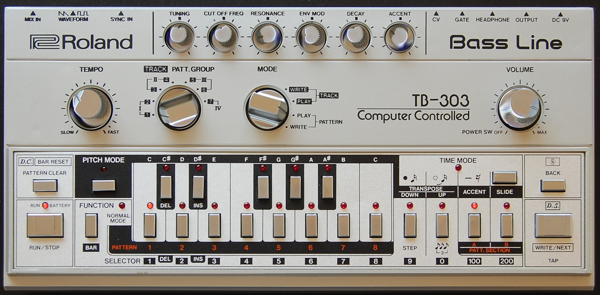

# Roland TB-303 photographic front panel

Choose **Panel → Roland TB-303 (photo)**, or run **`python3 Launch_Roland_TB303.py`**. To return, choose **Panel → Studio skins** or select any of the eleven instruments under **Skin**. Both views use the same open project, undo history and audio transport. The ordinary launcher still opens Steampunk.

The front panel is the supplied 1656 × 814 JPEG. The only moving areas are the ten photographed knob heads, twenty-four switch caps and twenty-one red lenses. Engraving, bezels, panel seams and labels stay fixed. The front is shown at native size when there is room and scales as a unit on smaller displays. Hold **F9**, or select **Panel → Reference photo only**, to see the untouched image. [Watch the running demonstration](docs/Roland-TB303-Panel-Demo.gif).

## Turning a knob

- Drag the centre up/down for a precise adjustment, or drag the rim in a circle. The wheel makes small changes. **TUNING** is logarithmic; noon is A = 440 Hz. **TEMPO** covers 40–300 BPM. The angle reflects the current value even when you turn a MIDI controller or recall a project.
- Click a printed dot beside **MODE** or **TRACK / PATT. GROUP** to jump to that detent. The seven track positions map to groups I/I, II/II, III/III, IV in Pattern mode. To change Pattern Play groups, stop first. Turning the mode switch stops the transport.
- The waveform switch is on the rear of the original instrument. Click the **WAVEFORM** legend or use **Panel → Rear waveform switch**. Click **POWER SW OFF** or turn **VOLUME** to zero and one notch further to switch off the virtual panel. The keys go dark; volume clockwise powers it back on.

## The four modes

| Selector position | Try this on the photo |
| --- | --- |
| Pattern Play | Choose A/B with the **ACCENT / SLIDE** pair; choose 1–8 with the white keys. Press **RUN/STOP**. A new slot takes over at the next pattern boundary. Hold two numbered switches in the same block (1–4 or 5–8) to chain an inclusive range. A change requested during a chain waits for its last pattern. While running, hold **PITCH MODE** and a note to shift at a boundary; changing pattern cancels that shift. While stopped, the same chord selects a reference pitch for **TAP**. |
| Pattern Write | **PITCH MODE** writes chromatic notes. Hold an octave key, **ACCENT** or **SLIDE** as you enter one. Hold **WRITE/NEXT** to hear and inspect a stored note; while holding it, accent/slide toggle the stored flags. **BACK** returns to the previous entry for correction. **FUNCTION** alone returns to normal. |
| Pattern Write: timing | Press **TIME MODE** (the small silver button to the right of its lamp), then the first three white keys at the right: **9 = note**, **0 = tie**, **100 = rest**. The last entry returns to normal. In normal mode, hold **FUNCTION** and tap **9** once per desired step; **FUNCTION + 0** selects twelve triplet steps. These length operations reset the rhythm. Hold the pattern number and press **PATTERN CLEAR** to blank timing while keeping pitches. For tap writing, run in Pattern Write, press **PATTERN CLEAR**, tap **WRITE/NEXT**, then stop to commit. |
| Track Write | Select track 1–7. Choose a pattern, then **WRITE/NEXT** to enter a bar. **PITCH MODE + note** chooses its transposition. In stop, **FUNCTION + DEL/INS** deletes a bar or prepares insertion; **BACK** moves back a bar. In run, **D.C.** or **segno** (on BACK) marks the next bar you write. |
| Track Play | **RUN/STOP** starts the selected track from the chosen bar. **BAR RESET** returns to bar one and **D.S.** requests a jump to the stored segno at the next boundary. Hold **FUNCTION / BAR** to inspect the bar number. Hold **PITCH MODE** to see the playing bar’s transposition. |

**BACK is contextual.** The photographed BACK key corrects entries or serves as segno according to mode. The Studio's **BACK – Undo** and **REDO** still work with **Ctrl+Z / Ctrl+Y**; modern **PREV/NEXT** remain cursor commands.

## Reading the lights

- **RUN/BATTERY** stays on while playback runs and goes out on stop. When armed for external MIDI clock, simply arming the transport does not light RUN: incoming clock must actually be advancing.
- In normal Pattern Play, **1–8 identify patterns**. A/B identify the section. These lamps are not a sixteen-step note chase or VU meter. In Track Play, they follow the pattern in the sounding bar.
- In Pitch entry/review, the keyboard lamps identify the pitch; the transpose and accent/slide lenses indicate the associated properties. Time entry has its own mode indicator and note/tie/rest feedback. The red glass stays visible when a lamp is off.
- The audio engine decides exactly when patterns change. Tk samples that state for display; visual refresh, the idle blink rate and brightness are software approximations, not measurements on an original unit.

## One mouse, two held switches

| Hardware function | Computer keyboard |
| --- | --- |
| C, C♯, D, D♯, E, F, F♯, G, G♯, A, A♯, B, high C | Z S X D C V G B H N J M Q |
| FUNCTION / PITCH MODE / TIME MODE | F or Shift / P / T |
| TRANSPOSE DOWN / UP | [ / ] |
| ACCENT / SLIDE | comma / period |
| RUN/STOP / WRITE-NEXT / BACK / CLEAR | Space / Enter / Backspace / Delete |

For example, in Pattern Write press **P**, then hold **comma** and click the black **F♯** cap to write an accented F♯. No modifier is sticky. If the photo loses keyboard focus, held keys are released. With the Studio's external MIDI Clock armed, the master owns the tempo.

## Scope and reference

The physical layout and moving materials come from **Roland_TB-303_Panel.jpg** ([Wikimedia Commons](https://commons.wikimedia.org/wiki/File:Roland_TB-303_Panel.jpg), public domain under CC0 1.0), included unmodified under `doc/skin/Roland_Photo/`. Roland and TB-303 are trademarks of Roland Corporation; this project is not affiliated with Roland. The [Roland TB-303 owner’s manual](https://cdn.roland.com/assets/media/pdf/TB-303_OM.pdf) describes pitch/time entry (printed pp. 12–19), tuning (pp. 33–34), Pattern Play (pp. 47–48) and chaining (pp. 56–58). This is a front end to the Studio's synthesis and project format, not the original firmware. The Studio keeps its own 64-bar-per-track limit, per-pattern sound settings, legacy instruments and project files. The rear audio/CV/gate/DIN sockets and battery voltage are not simulated; the RUN lens represents playback. No sound or timing comparison against a physical TB-303 is claimed.
